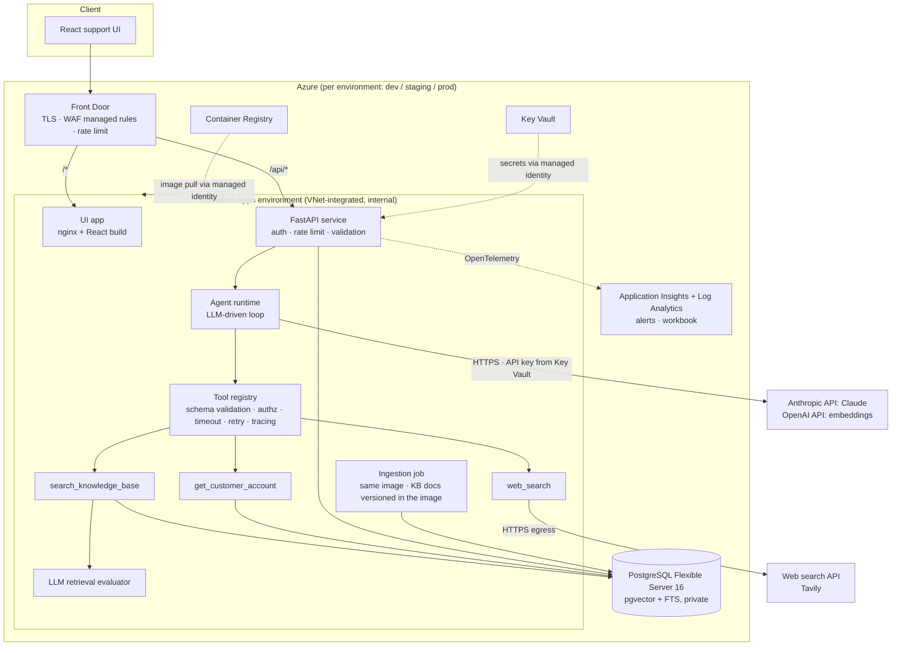

# Architecture

> Status: implemented. Sections 1–3 are the pre-implementation proposal; sections 4+ describe the
> system as built. Decisions that changed during implementation are listed in section 8.

## 1. Context and goals

CloudBox is a fictional SaaS file-storage / API platform. We need a customer-support assistant that:

* answers from **CloudBox's own documentation** (never invented policy),
* can look at **the customer's account** when the answer depends on it,
* can fall back to the **public web** for non-CloudBox knowledge, clearly labelled,
* **decides for itself** which of those to use, in what order, and when it has enough evidence,
* is measurable against a plain RAG baseline, observable, secure, and deployable.

## 2. Key decisions

| # | Decision | Alternatives considered | Why |
|---|----------|-------------------------|-----|
| D1 | **Hand-written agent loop over a provider-neutral LLM interface** (`backend/agent/loop.py`) | LangGraph / LangChain agents; Anthropic SDK Tool Runner | The loop is ~150 lines and *is* the product. Owning it gives us exact budget control (steps, tool calls, wall clock), per-step tracing, authorization in the tool layer, and provider portability. A graph framework invites encoding the trajectory as edges — the thing the brief forbids. |
| D2 | **Exactly three capability tools**; "answer" and "ask a clarifying question" are the model's *terminal natural-language reply*, not tools | A 4th `respond`/`final_answer` tool | The brief asks for exactly three tools. The terminal reply carries a one-line type tag (`answer` / `clarification` / `cannot_verify`) and inline evidence markers (`[K3]`, `[W1]`, `[A1]`) that the output validator checks. |
| D3 | **Retrieval evaluator runs inside `search_knowledge_base`** and its verdict is returned *as part of the observation* | Grader as a separate graph node that routes | The grader informs; the agent decides. Nothing in application code branches on the verdict. |
| D4 | **Postgres + pgvector** is the single data plane (chunks, customers, sessions, traces) with **hybrid retrieval** (pgvector cosine + Postgres full-text, fused with Reciprocal Rank Fusion) | Dedicated vector DB (Pinecone/Qdrant/OpenSearch) | One managed service (RDS) to secure, back up and pay for. Support content is full of exact tokens (`429`, `CBX-4031`, `cbx_live_`) where lexical matching beats embeddings; hybrid gets both. pgvector HNSW is more than adequate for < 10M chunks. |
| D5 | **Structure-aware chunking** (heading tree, tables kept whole with header rows, one chunk per FAQ pair, breadcrumb prefix, cross-reference metadata) | Fixed-size token windows | Policies are hierarchical and exception-heavy; a fixed window separates an exception from the rule it modifies. |
| D6 | **Authorization lives in the tool layer, not the prompt** | Rely on system prompt instructions | A prompt-injected model can be talked into anything; a tool that refuses to read another customer's account cannot. Customer IDs must come from the authenticated principal or from the *user's own* messages — never from retrieved content. |
| D7 | **Untrusted-content envelope** for every KB chunk and web page + heuristic injection flagging + output validation | Trusting the corpus | Documents and web pages are data, never instructions. |
| D8 | **Azure hosts the whole application** (project requirement): Front Door (Premium in staging/prod) + WAF (TLS, rate limiting, OWASP/bot rules) → Azure Container Apps (API and UI apps in a VNet-integrated environment; ingress admits only the AzureFrontDoor.Backend service tag and the API verifies `X-Azure-FDID`); Azure Database for PostgreSQL Flexible Server 16 + pgvector (private VNet integration); Key Vault (RBAC) for secrets; Azure Container Registry; Log Analytics + Application Insights; Container Apps Job for ingestion — all Terraform (`azurerm`) | AKS; App Service | Container Apps gives scale-to-zero (dev cost), revisions/traffic splitting and managed identity without running Kubernetes. PostgreSQL Flexible Server supports `vector` natively. Front Door WAF provides the distributed rate limit the app cannot. AKS is overkill for two containers. |
| D9 | **Evaluation = deterministic grading first, optional LLM judge second**, hermetic web-search fixtures | LLM-as-judge only | Fact-match grading is reproducible, free and cannot be gamed by fluent prose. The judge is reported separately and only when a judge model is configured. Fixture web search keeps the benchmark reproducible. |
| D10 | **Provider abstraction**: `AnthropicProvider` (Claude via the Anthropic API — the default; Microsoft Foundry also supported), `OpenAIProvider` (OpenAI API — embeddings by default; any OpenAI-compatible endpoint) and `OllamaProvider` (offline local dev) | Single SDK | Required by the brief. Models are called over HTTPS from the Container Apps; their API keys live in Key Vault and reach the app as Key Vault references. Settings validation refuses local/test providers (Ollama, scripted, hashing) in staging/prod. |

## 3. Risks and trade-offs (identified up front)

| Risk | Mitigation |
|------|------------|
| The agent costs more and is slower than plain RAG | Measured, not assumed — see `docs/evaluation.md`. Budgets (`MAX_AGENT_STEPS`, `MAX_TOOL_CALLS`, wall-clock deadline) bound worst case. |
| The LLM evaluator adds a model call per search | It runs on Claude Haiku 5.5 (≈ $0.0006 per search, measured) and does double duty as the re-ranker, so re-ranking adds no call. It can be disabled (`RETRIEVAL_EVALUATOR_ENABLED=false`); its cost is reported separately. |
| Small/local models follow the tool protocol poorly | Lenient output parsing, citation guardrail, forced finalization at the step limit. Results are reported per model — small-model numbers are not extrapolated to frontier models. |
| Prompt injection cannot be fully prevented by prompting | Defense in depth: envelope + flagging + tool-level authorization + PII guard on outbound web queries + output validation. Tested with an injected document and an injected web page. |
| Fixture web search ≠ the live web | Production uses Tavily behind the same interface; fixtures exist so evaluation is reproducible. |
| Small benchmark (~40 cases) → noisy rates | Counts are reported alongside percentages; per-category breakdown; raw per-case results are committed. |
| `AUTH_MODE=none` is convenient for demos and dangerous in prod | Settings validation refuses to boot with `AUTH_MODE=none` when `ENVIRONMENT=prod`. |

The remainder of this document (component diagram, request flow, data model, deployment
topology) is below.

## 4. Component diagram



## 5. Request flow

1. `POST /api/v1/chat` → request-ID middleware → security headers → rate limiter → auth (principal).
2. Session is loaded (or created) and bound to the principal's customer ID.
3. `ContextBuilder` assembles: static system prompt (cached) + dynamic session context
   (date, known customer ID, IDs the user mentioned, summary of older turns) + last *N* turns + the new message.
4. **Agent loop** (`backend/agent/loop.py`):
   ```text
   for step in 1..MAX_AGENT_STEPS:
       response = llm.complete(system, messages, tools)       # model chooses
       if response has no tool calls: finalize(response.text)  # model chose to answer/clarify
       results = execute(response.tool_calls)                  # in parallel, each bounded
       messages += [assistant(response), tool_results(results)]
   finalize_with_tools_disabled()                              # safety boundary only
   ```
5. `finalize` → output validator: strip unknown citation IDs, enforce the web-source disclaimer,
   redact secrets/PII, classify the response type, compute evidence/confidence summary.
6. Turn persisted to the session; trace persisted and logged; metrics emitted.
7. Response: answer, typed sources (`internal_kb` / `public_web` / `customer_account`), safe activity
   events, tool-call summaries, usage/cost, evidence summary. No chain of thought.

## 6. Data model (PostgreSQL)

| Table | Purpose |
|-------|---------|
| `kb_index_meta` | embedding model + dimension the index was built with (guards against mixing models) |
| `kb_documents` | one row per source document, content hash for idempotent re-ingestion |
| `kb_chunks` | chunk text, breadcrumb, metadata JSONB, `tsvector` (generated), `vector(d)` with HNSW index |
| `customers` | mock customer accounts (JSONB) — stands in for the billing/CRM system of record |
| `sessions` | conversation state (bound customer, turns, facts) |
| `agent_traces` | per-execution trajectory (tool calls, observations summaries, usage) for inspection |

## 7. Package layout

```text
backend/
  agent/          loop, prompts, context builder, evidence ledger, output validation
  tools/          tool base + registry, the three tools, web-search providers
  retrieval/      parsing, chunking, embeddings, vector stores, retriever, ingestion, evaluator
  models/         LLM provider abstraction (anthropic, openai, ollama, scripted)
  evaluation/     offline benchmark: dataset, baseline RAG, runner, metrics, judge, report
  api/            FastAPI app, routes, middleware, dependencies
  schemas/        typed API + domain models
  config/         environment-based settings, model pricing
  observability/  structured logging, tracing, metrics, cost
  security/       auth, authorization policy, injection + PII guards, rate limiter
  storage/        Postgres pool + migrations, session store, customer repository
```

## 8. Decisions that changed during implementation

| Change | Why |
|--------|-----|
| **AWS → Azure** | Project requirement received mid-build ("use Azure, not anything else"). The application already depended only on interfaces, so the change touched the provider factory, settings, telemetry and Terraform — not the agent, tools or retrieval. |
| **Models: Anthropic API (Claude) + OpenAI API (embeddings), not Azure-hosted models** | "Use Azure" means Azure *hosts the application* (compute, data, network, secrets, monitoring — all Terraform). An intermediate version also moved the models to Microsoft Foundry / Azure OpenAI; that was a misreading and was reverted. The model API keys are stored in Key Vault. |
| **Passwordless PostgreSQL (Entra ID tokens)** | Password auth is disabled on the server; the app's managed identity token is the password (`DATABASE_AUTH=entra`). No DB secret exists in code, CI, Key Vault or Terraform state. |
| **UI as a Container App instead of a Storage static website** | Static-website configuration and uploads are data-plane operations that need extra RBAC propagation and network exceptions for CI runners. A second (scale-to-zero) Container App reuses the same pipeline, WAF path and image scanning. |
| **Terraform manages no Key Vault secret values** | Avoids data-plane access from CI and secret values in state. App secrets are opt-in Key Vault references (`app_secrets`), added after operators create the secret. |
| **Benchmark models** | The laptop available for development has no GPU and 8 GB RAM; a local 4B model took ~3 minutes per call and skipped tool use, so local runs and the benchmark use the Anthropic and OpenAI APIs. Ollama remains supported for fully offline development. |
